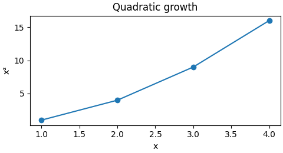
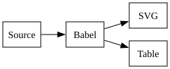
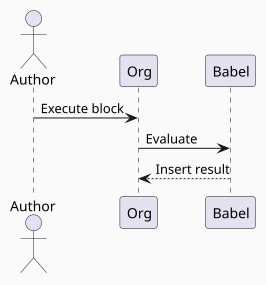
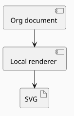

#+title: Демонстрация Org Workspace
#+startup: showeverything linkpreviews

* Документы
** Текст и вложения
Этот документ хранит исходники рядом с результатами. Каталог
=org-workspace-assets/= перемещается вместе с документом.

Ниже обычное изображение PNG. Его создаёт блок =python-plot=.

** Математика
Формула для локального предпросмотра. Поставьте курсор на формулу и нажмите =C-c C-x C-l=.

\[
\sum_{k=1}^{n} k = \frac{n(n+1)}{2}
\]

* Рисование
** Редактируемый SVG
Откройте рисунок командой =C-c C-o= на ссылке или через контекстное меню.
В панели edraw можно рисовать мышью. =C-c C-c= сохраняет рисунок в SVG.

[[edraw:file=./org-workspace-assets/drawing.edraw.svg]]

** Карта мыслей
Внутри карты =TAB= добавляет дочерний узел, =RET= добавляет соседний,
=M-RET= редактирует текст, а =C-c C-c= перестраивает карту.

#+begin_mindmap
            ╭─ Org
«Документы» ┼─ Рисунки
            ╰─ Данные
#+end_mindmap

* Локальные диаграммы
** Graphviz
#+name: graphviz-demo
#+begin_src dot :file org-workspace-assets/graphviz.svg :results file graphics
digraph {
  rankdir=LR;
  node [shape=box];
  Source -> Babel;
  Babel -> SVG;
  Babel -> Table;
}
#+end_src

#+RESULTS: graphviz-demo

** PlantUML sequence
Светлый фон задаётся в самом SVG, чтобы диаграмма читалась и в тёмной теме.

#+name: plantuml-sequence
#+begin_src plantuml :file org-workspace-assets/sequence.svg :results file graphics
skinparam backgroundColor #FAFAFA
actor Author
participant Org
participant Babel
Author -> Org: Execute block
Org -> Babel: Evaluate
Babel --> Org: Insert result
#+end_src

#+RESULTS: plantuml-sequence

** PlantUML component
#+name: plantuml-component
#+begin_src plantuml :file org-workspace-assets/component.svg :results file graphics
skinparam backgroundColor #FAFAFA
!pragma layout smetana
component "Org document" as Document
component "Local renderer" as Renderer
artifact "SVG" as Image
Document --> Renderer
Renderer --> Image
#+end_src

#+RESULTS: plantuml-component

* Python Babel
** Числовой результат
#+name: python-scalar
#+begin_src python :results value scalar
return sum(range(1, 11))
#+end_src

#+RESULTS: python-scalar
: 55

** Таблица pandas
Передайте Org заголовок и строки как списки значений. =None= между
заголовком и данными обозначает горизонтальную линию.

#+name: python-table
#+begin_src python :results value table
import pandas as pd

frame = pd.DataFrame({"name": ["alpha", "beta"], "score": [3, 5]})
return [frame.columns.tolist(), None, *frame.to_numpy().tolist()]
#+end_src

#+RESULTS: python-table
| name  | score |
|-------+-------|
| alpha |     3 |
| beta  |     5 |

** Именованная сессия
Выполните блоки сверху вниз. Оба используют отдельный процесс =org-workspace-demo=.

#+name: python-session-init
#+begin_src python :session org-workspace-demo :results value scalar
values = [3, 5, 8]
len(values)
#+end_src

#+RESULTS: python-session-init
: 3

#+name: python-session-read
#+begin_src python :session org-workspace-demo :results value scalar
sum(values)
#+end_src

#+RESULTS: python-session-read
: 16

** График Matplotlib
#+name: python-plot
#+begin_src python :results file graphics :file org-workspace-assets/plot.png
from pathlib import Path

import matplotlib

matplotlib.use("Agg")
from matplotlib import pyplot as plt

output = Path("org-workspace-assets/plot.png")
output.parent.mkdir(parents=True, exist_ok=True)
fig, ax = plt.subplots(figsize=(4.8, 2.6), layout="constrained")
ax.plot([1, 2, 3, 4], [1, 4, 9, 16], marker="o")
ax.set(xlabel="x", ylabel="x²", title="Quadratic growth")
return fig
#+end_src

#+RESULTS: python-plot

* PostgreSQL Babel
Запрос использует отдельный тестовый сервер на =127.0.0.1:55432=.
Как его запустить после перезагрузки Windows, описано в [[file:ORG-WORKSPACE.md]].

#+name: postgres-demo
#+begin_src sql :engine postgresql :dbhost 127.0.0.1 :dbport 55432 :dbuser org_demo :database postgres :cmdline -X -w :colnames yes :results value table
SELECT
    1 AS id,
    'hello' AS message;
#+end_src

#+RESULTS: postgres-demo
| id | message |
|----+---------|
|  1 | hello   |
